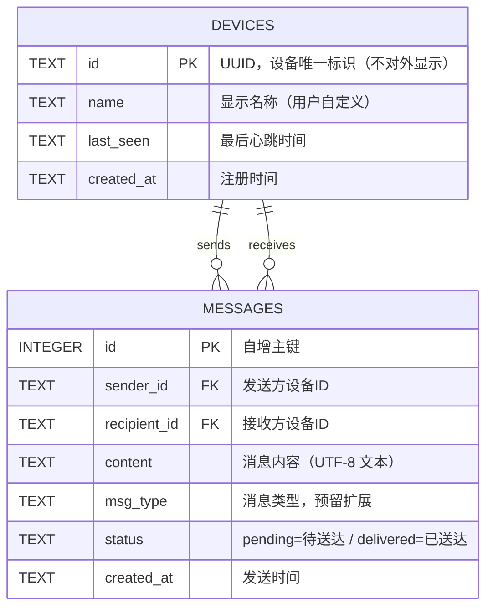

# 局域网设备信息互发系统 — 方案设计

> 版本：v0.1（方案评审稿） · 日期：2026-08-20 · 状态：待评审

---

## 1. 项目概述

在**同一局域网**内，实现设备间文字信息的互相发送。

- **运行形态**：一台设备（通常为 Windows 电脑）运行 Python 服务，其他设备（安卓手机、Windows 电脑、平板等）通过**浏览器**直接访问，无需安装任何 App。
- **核心能力**：
  - 设备注册与唯一身份（内部 UUID，对外只显示自定义设备名称）
  - 在线状态实时感知（WebSocket 心跳）
  - 实时文字互发（字符信息）
  - **离线消息缓存**：目标设备不在线时消息先暂存，目标上线后自动补发
- **适配性**：响应式 Web UI，一套前端同时适配电脑宽屏与手机窄屏。
- **扩展性**：数据模型预留 `msg_type`、`status` 等字段，后续可扩展图片/文件传输、群发、已读回执等。

---

## 2. 架构设计

### 2.1 总体架构（中央服务模式）

```
┌──────────────────────── 局域网 (WiFi / 路由器) ────────────────────────┐
│                                                                        │
│   ┌──────────────┐      HTTP (页面/API)       ┌──────────────────┐     │
│   │  Windows 电脑 │  ◄──────────────────────► │  安卓手机 · 浏览器  │     │
│   │  = 服务主机    │                            │  (Chrome/Edge)    │     │
│   │  (Python)    │      WebSocket (实时)      └──────────────────┘     │
│   │              │  ◄──────────────────────►                            │
│   │              │                            ┌──────────────────┐     │
│   │              │                            │ Windows · 浏览器   │     │
│   │              │                            └──────────────────┘     │
│   └──────┬───────┘                                                    │
│          │                                                             │
│          ▼                                                             │
│   ┌──────────────┐                                                    │
│   │   SQLite      │   设备表 + 消息表（含离线消息队列）                    │
│   └──────────────┘                                                    │
└────────────────────────────────────────────────────────────────────────┘
```

**模式说明**：
- **主机（Host）**：运行 `python main.py` 的设备，负责提供 Web 服务、维护在线状态、缓存离线消息。同一局域网内只有一台主机。
- **客户端（Client）**：任意设备上的浏览器，通过 `http://<主机IP>:8000` 访问。无需安装软件，手机扫码即可进入。
- **为什么不选 P2P 直连**：P2P 需要每台设备都跑服务，且手机端跑 Python 服务不现实；浏览器是天然的跨平台客户端，中央服务模式实现简单、可靠、易扩展。

### 2.2 技术选型

| 层次 | 选型 | 理由 |
|------|------|------|
| Web 框架 | **FastAPI** + Uvicorn | 类型安全（Pydantic v2）、原生 WebSocket、异步高性能、自动生成 API 文档 |
| 实时通信 | **WebSocket** | 双向实时、承载在线状态心跳与消息实时推送 |
| 存储 | **SQLite**（标准库 `sqlite3`） | 单文件零配置、局域网设备规模（几十台）完全够用、无需装数据库 |
| 前端 | **原生 HTML/CSS/JS**（单页） | 无需 Node 构建链、响应式适配双端、依赖最少、便于维护 |
| 二维码 | `qrcode` 库 | 启动时生成访问地址二维码，手机扫码直达 |
| 包管理 | `requirements.txt`（备选 uv） | 保持简单 |
| 代码质量 | Ruff（lint+format）+ pytest | 工程化基线 |
| 网络发现 | 启动时自动探测本机局域网 IP 并打印 | 免手动查 IP |

### 2.3 项目目录结构（分层架构）

```
局域网信息分享/
├── main.py                      # 入口：uvicorn 启动 + 打印访问地址 + 生成二维码
├── requirements.txt
├── pyproject.toml               # 项目配置 + Ruff + pytest
├── app/
│   ├── __init__.py
│   ├── config.py                # pydantic-settings：端口 / 服务名 / DB 路径
│   ├── database.py              # SQLite 连接 + 建表（devices / messages）
│   ├── schemas.py               # Pydantic 模型：DeviceCreate / DeviceOut / MessageOut ...
│   ├── dependencies.py          # FastAPI 依赖注入（db 连接、当前设备）
│   ├── services/
│   │   ├── __init__.py
│   │   ├── device_service.py    # 设备注册 / 查询 / 名称修改
│   │   ├── message_service.py   # 消息写入 / 离线消息查询 / 状态更新
│   │   └── presence.py          # 在线状态管理器（内存中的设备→WS 连接映射）
│   ├── api/
│   │   ├── __init__.py
│   │   └── v1/
│   │       ├── __init__.py
│   │       ├── devices.py       # POST /devices/register  GET /devices
│   │       ├── messages.py      # POST /messages  GET /messages/{device_id}/pending
│   │       └── ws.py            # WS /ws 连接管理、心跳、消息推送
│   └── utils/
│       └── network.py           # 获取本机局域网 IP、生成二维码
├── static/
│   ├── index.html               # 单页应用（响应式）
│   ├── css/style.css            # 双端适配样式
│   └── js/
│       ├── app.js               # 页面主逻辑（路由切换、渲染）
│       ├── api.js               # REST 封装
│       └── ws.js                # WebSocket 客户端（心跳、重连、收消息）
├── tests/
│   ├── conftest.py
│   ├── test_api_devices.py
│   ├── test_api_messages.py
│   └── test_ws.py
└── README.md
```

> 说明：此规模项目采用**扁平化分层**（schemas/services/api 各自单文件），避免过度分层；后续若扩展文件传输等功能再拆分 models/ 目录。

---

## 3. 数据表设计（SQLite）



| 表 | 字段 | 说明 |
|----|------|------|
| `devices` | `id` (TEXT PK) | UUID v4，服务端生成，**只在服务端内部使用，不显示给用户** |
| | `name` | 设备显示名称，如"我的手机"、"书房电脑"，用户可改 |
| | `last_seen` | 最近一次心跳时间，用于离线判定兜底 |
| `messages` | `id` (INTEGER PK) | 自增 |
| | `sender_id` / `recipient_id` | 消息双方设备 ID，均建立索引 |
| | `content` | 字符消息内容 |
| | `msg_type` | 当前恒为 `text`；预留 `image` / `file` |
| | `status` | `pending` 离线暂存 → `delivered` 已推送；预留 `read` 已读 |

**离线消息队列即 `status='pending'` 的消息行**：目标上线建立 WebSocket 后，服务端批量查询并推送，随即置为 `delivered`。

---

## 4. 核心流程

### 4.1 服务启动（主机侧）

```
python main.py
  ├─ 读取配置（端口 9777）
  ├─ 探测本机局域网 IP（如 192.168.1.100）
  ├─ 打印访问地址 http://192.168.1.100:8000
  ├─ 生成同地址二维码（qrcode → 终端显示 / 保存 png）
  └─ 启动 uvicorn（FastAPI app）
```

### 4.2 设备接入（客户端侧，一次性的身份建立）

```
浏览器访问 http://<IP>:8000
  ├─ 读取 localStorage 中的 deviceId
  ├─ 不存在 → 弹出「设置设备名称」→ 向后端 POST /api/v1/devices/register
  │        → 后端生成 UUID 返回 → 存入 localStorage（此后不再弹出）
  ├─ 存在   → 直接进入主界面
  └─ 建立 WebSocket 连接（携带 deviceId），服务端标记该设备在线
```

- 设备名称可随时在界面右上角修改（PUT /api/v1/devices/{id}/name）。
- 同一浏览器只产生一个设备身份；换设备/换浏览器 = 新设备。

### 4.3 在线状态维护

```
客户端 ──(每 30s 发送心跳 {type:"ping"})──► 服务端
服务端记录 last_seen，维护 {device_id: WebSocket} 内存映射
服务端后台任务每 60s 扫描：超过 90s 未心跳 → 标记离线（内存 + 广播状态变更）
客户端断线 → 前端自动重连（指数退避，上限 30s）
```

### 4.4 消息发送（在线/离线两条路径）

```
用户在聊天窗口输入 → POST /api/v1/messages {recipient_id, content}

服务端判断目标在线？
 ├─ 在线 → 通过 WebSocket 实时推送 → status=delivered
 └─ 离线 → 写入 messages 表 status=pending（缓存成功，返回"已缓存，对方上线后送达"）

目标设备上线（WebSocket 建立）→
  服务端立即查询该设备所有 status=pending 的消息
  → 逐条推送 → 置为 delivered
```

**关键点**：发送方无需关心目标是否在线——由服务端统一兜底，这正是"信息缓存、上线后补发"需求的落点。

---

## 5. UI 设计（双端适配）

设计原则：**响应式布局，一套代码两端适配**；以 768px 为断点。

### 5.1 电脑端布局（宽屏 ≥768px）—— 左列表 + 右聊天

```
┌──────────────────────────────────────────────────────────────┐
│ 顶栏  ● 局域网信息互发   我的设备: 书房电脑 [改]   在线设备: 3 │
├───────────────┬──────────────────────────────────────────────┤
│  设备列表       │  聊天窗口                                     │
│               │  ┌──────────────────────────────────────────┐ │
│  ● 我的手机     │  │  会话对象: 我的手机          ● 在线       │ │
│  ○ 书房电脑     │  │                                          │ │
│  ● 客厅平板     │  │  (对方) 今晚回来吃饭吗？                   │ │
│               │  │  (我) 回，7点到                         │ │
│  [+ 添加设备]   │  │  (对方) 好，等你                       │ │
│  ▼ 展开:       │  │                                          │ │
│  离线设备折叠区  │  └──────────────────────────────────────────┘ │
│               │  [ 输入字符消息…………………………………… ]  [ 发送 ]  │
├───────────────┴──────────────────────────────────────────────┤
│ 状态栏 服务运行中 · 端口 9777 · 访问地址 192.168.1.100:9777    │
└──────────────────────────────────────────────────────────────┘
```

布局要点：
- **左栏**：设备列表卡片（头像圆点 + 名称 + 在线状态圆点：绿=在线 / 灰=离线），按在线优先排序；底部"+ 添加设备"实为"用浏览器另开一个身份"或展示扫码入口。
- **右栏**：会话标题（对方名称 + 在线状态）、消息气泡流（自己靠右蓝/绿底，对方靠左白底）、底部输入区。
- **顶栏**：服务名 + 我的设备名（可改名）+ 在线设备计数。
- **状态栏**：展示访问地址，方便其他设备加入。

### 5.2 手机端布局（窄屏 <768px）—— 两级导航

**① 设备列表页（首页）**

```
┌──────────────────────────────┐
│  局域网信息互发      ● 我的手机 │
├──────────────────────────────┤
│  ● 书房电脑          在线     │
│  ○ 客厅平板          离线     │
│  ● 我的手机          在线     │
│                              │
│  ┌──────────────────────┐   │
│  │  + 邀请新设备（扫码/复制地址） │
│  └──────────────────────┘   │
├──────────────────────────────┤
│  底部导航: [设备] [我的]      │
└──────────────────────────────┘
```

**② 聊天页（点击设备进入）**

```
┌──────────────────────────────┐
│ ←  书房电脑        ● 在线     │
├──────────────────────────────┤
│   (对方) 今晚回来吃饭吗？      │
│                              │
│   (我) 回，7点到             │
│                              │
│   (对方) 好，等你             │
│                              │
│  ── 对方上线了，离线消息已送达 ──│
├──────────────────────────────┤
│  [ 输入字符消息…… ]  [发送]    │
└──────────────────────────────┘
```

布局要点：
- **两级导航**：列表页 → 点设备 → 聊天页（顶栏返回箭头），符合移动端习惯。
- **底部输入条**：固定吸底，输入框 + 发送按钮（手机端按钮加宽，方便拇指点击）。
- **系统消息**：用居中灰字展示"对方上线了"、"离线消息已送达"等状态提示。
- 断网/重连时顶部出现黄色提示条"连接断开，重连中…"。

### 5.3 断点与响应策略

| 断点 | 设备 | 布局 |
|------|------|------|
| ≥768px | 电脑 / 平板横屏 | 左列表 + 右聊天，同屏显示 |
| <768px | 手机 / 平板竖屏 | 列表页 ↔ 聊天页切换 |

### 5.4 视觉基调

- 微信/Telegram 风格聊天界面：自己消息 `#1D9E75`（绿）靠右，对方消息白色靠左，气泡圆角 12px。
- 在线状态：绿点 `#3B6D11` / 灰点 `#B4B2A9`。
- 顶栏与输入条使用浅灰表面色，内容区白色。
- 移动端输入框高度 ≥44px，满足触控规范。

---

## 6. 安全与边界（本期范围）

| 项 | 本期处理 |
|----|----------|
| 鉴权 | 局域网信任环境，**不设登录密码**；可选后续加 PIN 码 |
| 传输 | HTTP/WS 明文（局域网内）；后续可加 TLS（自签证书） |
| 消息留存 | SQLite 持久化；**本期含"清空历史"按钮**（清空指定会话 / 全部） |
| 规模 | 目标 ≤ 50 台设备、消息量 ≤ 10 万条，SQLite 无压力 |
| 防火墙 | 首次运行提示 Windows 防火墙放行 9777 端口（需管理员） |
| 数据 | 纯本地文件（lan_share.db），不依赖外网 |

---

## 7. 扩展规划（后续）

| 优先级 | 功能 | 涉及改动 |
|--------|------|----------|
| P1 | 图片 / 文件传输 | `msg_type` 已有，新增上传接口 + WS 二进制 |
| P1 | 群发 / 广播（全员） | 新增 `broadcast` 路由 |
| P2 | 已读回执 | `status` 增加 `read`，WS 增加 ack 消息 |
| P2 | 浏览器桌面通知 | 前端 Notification API |
| P2 | 设备改名 / 删除设备 | REST 已有雏形 |
| P3 | 消息加密（AES 预共享密钥） | 前后端加密层 |
| P3 | 多主机 / 云端中继 | 架构升级为中继模式 |

---

## 8. 开发里程碑

| 里程碑 | 内容 | 验收标准 |
|--------|------|----------|
| **M1 服务骨架** | FastAPI 工程 + SQLite 建表 + 设备注册 API + 首页 | 浏览器能注册设备、看到设备列表 |
| **M2 实时通道** | WebSocket 连接 + 心跳 + 在线状态广播 | 双设备互见在线状态变化 |
| **M3 消息互发** | 发消息 API + 实时推送 + 聊天窗口渲染 | 双端实时收发文字消息 |
| **M4 离线缓存** | pending 消息队列 + 上线补发 | 目标离线发送，上线后自动收到 |
| **M5 双端适配** | 响应式 UI 完善（电脑/手机）+ 二维码入口 + 改名 | 手机扫码即用，双端体验完整 |
| **M6 质量收尾** | pytest 用例 + Ruff + README + 启动脚本（.bat） | 测试通过，一条命令启动 |

**建议开发顺序**：M1 → M3（先打通实时链路，M2 并入 M3）→ M4 → M5 → M2 补心跳健壮性 → M6。

---

## 9. 依赖清单（requirements.txt）

```
fastapi>=0.115
uvicorn[standard]>=0.30
pydantic>=2.7
qrcode>=7.4
pytest>=8.0        # dev
ruff>=0.5          # dev
```

安装：`pip install -r requirements.txt`

运行：`python main.py` → 终端显示 `http://192.168.x.x:9777` 与二维码。

---

## 10. 已确认决策（2026-08-20）

| # | 决策点 | 结论 |
|---|--------|------|
| 1 | 服务端口 | **9777**（访问地址 `http://IP:9777`） |
| 2 | 历史消息 | **本期包含**"清空历史"按钮（清空指定会话 / 全部） |
| 3 | UI 风格 | **微信式聊天风格**（绿色气泡靠右 / 白色气泡靠左） |
| 4 | 实施节奏 | **先实施 M1 服务骨架**（FastAPI 工程 + SQLite 建表 + 设备注册 API + 首页），跑通后由用户决定下一步 |

> 已按 M1 → M6 里程碑推进，当前处于 **M3/M4 已完成**（实时消息互发 + 离线缓存，v0.2.0），待用户验证后进入 M5（二维码入口等双端完善）。
